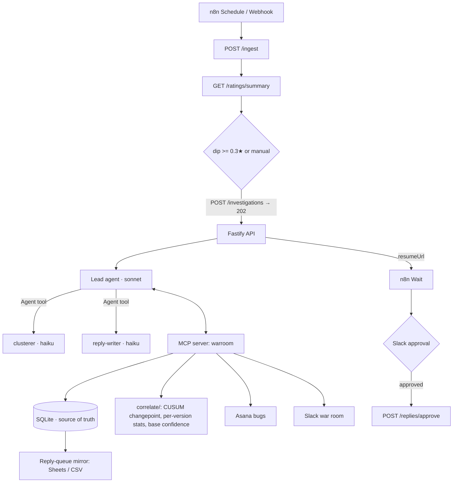

# review-war-room


**One ratings dip in; out comes the release that caused it, a confidence score computed in code, deduplicated bugs, and support replies that wait for a human to approve them, all in one Slack war-room thread.**

Nothing is ever published to a store: replies sit as `pending` until someone approves them in Slack, and approval only changes their status.

It finds the release that caused a ratings dip, backs the verdict with clustered review evidence and a confidence score computed in code, files deduplicated bugs for engineering, drafts policy-checked replies for support (held for human approval), and runs one Slack war-room thread for everyone.

<!-- GIF: verdict card landing in Slack, then the approval click (< 30s). Record with `npm run demo` + n8n. -->

```
SUSPECT: v4.2.0 (android)
confidence 0.95  (deterministic base 0.95)
- Android 4.2.0 avg 2.29 (n=133) vs 3.73 on other versions same period; 1-star share 42%
- Significant changepoint 2026-10-07 on Android: 3.68 -> 2.55 (z=8.1), one day after 4.2.0 release
- Login Loop cluster: 50.5% of 4.2.0 Android reviews vs 0% on other versions
- 4.2.0 changelog: auth migrated to new OAuth SDK; iOS 4.2.0 shows no comparable lift
```
*(Verdict evidence written by the live agent on the seeded dataset.)*

## Why

In 24 years of running production systems, I've learned that incidents need evidence, owners and a single thread. App reviews deserve the same. Ratings drops are usually noticed days late, and support, product and engineering each see a different piece of the picture. This puts all of it in one place within one run.

## Architecture



**The lead agent** (Claude Agent SDK `query()`, Sonnet) plans, delegates, reads the numbers, decides and hands off. It never sees raw review text.

**Two subagents** (`options.agents`, launched through the `Agent` tool) run on Haiku, because the bulk of the tokens is reading 600 short reviews, and that work doesn't need the bigger model:

| Agent | Model | Tools | Job |
|---|---|---|---|
| lead | `claude-sonnet-5-5` | plan, batches, clusters, merge, releases, correlate, verdict, open_bug, post_war_room, Agent | decide and hand off |
| clusterer | `claude-haiku-5-5` | list_clusters, get_review_batch, save_clusters | assign up to 4 batches of 50 reviews to a canonical taxonomy |
| reply-writer | `claude-haiku-5-5` | get_reviews_for_cluster, queue_reply | draft replies for the worst reviews, queue for approval |

### Things I made deterministic on purpose

- **The arithmetic.** `src/correlate/` computes per-version averages, a CUSUM changepoint with a z-score per platform, and each cluster's lift on the new version against reviewers still on older versions in the same window (this handles staged rollouts).
- **The confidence.** Base confidence = `0.10 + 0.30·timing + 0.25·lift + 0.10·platform + 0.25·rating`, capped at 0.95. The agent can move it by at most ±0.10 and must say why; `record_verdict` rejects anything else. An LLM's self-reported confidence isn't calibrated, so it doesn't get the final say.
- **Label stability.** Batch-by-batch LLM labelling drifts ("Login loop", "Can't sign in", "Login broken after update"). Each clusterer call starts from `list_clusters`, labels are normalised to slugs, `merge_clusters` turns duplicates into aliases, and each cluster has a fingerprint `sha1(kind:platform:slug)`. That's what makes the second run say "Login loop: +31 since last run" instead of opening a new ticket.

## Quick start (mock mode)

```bash
npm install
cp .env.example .env          # add ANTHROPIC_API_KEY
npm run demo                  # ingest the seeded dataset, run one investigation
npm run demo -- --two-runs    # run 1 on days 1–24, run 2 after the rest arrive: growth + no duplicate bugs
npm run trace                 # the latest run's trace, attributed per agent
```

Each run writes `runs/<id>/report.md`, `trace.jsonl`, and the mock outputs: `asana.json`, `slack.json` and `reply-queue.csv`.

**No API key?** `npm run demo -- --offline` runs the same pipeline with a keyword stand-in for the LLM (`src/agent/offline.ts`). It exists for CI and first-look demos. The verdict numbers still come from `src/correlate`.

The seeded dataset is regenerated with `npm run gen`. It has 600 reviews over 30 days with an Android login loop planted in v4.2.0 (changelog: *"Migrated auth to new OAuth SDK"*), background noise, an iOS release of the same version that is fine, and one prompt-injection review. Three other scenarios live in `fixtures/<name>/`.

### Using real public reviews

Set `MOCK_MODE=false` and `APP_ID_ANDROID` / `APP_ID_IOS` (any public app). Reviews are scraped read-only with `google-play-scraper` / `app-store-scraper` (optional dependencies). Asana, Slack and Google Sheets each switch to the real API when their credentials are set, and fall back to the mock file otherwise. Release history still comes from `fixtures/releases.json`; in production it would come from Crashlytics or the store APIs.

## Guardrails

**Prompt injection: capability isolation first.** Review text is an attack surface. The agents that read it (clusterer, reply-writer) have no Slack, Asana or verdict tools, and the lead, which has those tools, has no tool that returns raw review text. This is enforced twice: by each `AgentDefinition.tools` and by a `PreToolUse` hook that checks a capability map per `agent_type` (the hook also enforces plan-first and only allows the two defined subagents to be launched). A test asserts that no agent both reads review text and acts outbound.

Second layer:
- Reviews are scanned at ingestion and instruction-like text is neutralised before any agent sees it.
- Review text is delivered wrapped in `«»` with an UNTRUSTED notice.
- The Slack and Asana adapters refuse any payload that contains a verbatim span of a flagged review, instruction-like text, or something shaped like a secret.

**Reply policy** (`src/policy/replyPolicy.ts`): under 350 characters, no refund or credit promises, no blaming the user, no personal data (email, phone, card, SA ID), links only to the support domain, no secrets or instructions, and no verbatim echo of the review. A reply that fails comes back to the writer with reasons; it gets one revision.

**Never auto-publish.** Replies land in SQLite as `pending` and are mirrored to a Sheet or CSV. Approval flips them to `approved`. Nothing in this repo publishes to a store.

**Caps.** Lead `maxTurns 25`, `maxBudgetUsd 0.75` (the SDK's `total_cost_usd` includes subagent spend). Clusterer `maxTurns 12`, reply-writer 10. At most 3 bugs and 15 replies per run. Bugs are deduped by fingerprint and cluster across runs.

## n8n flow and approval

`n8n/review-war-room.json`: **Schedule (6h) / Webhook → POST /ingest → GET /ratings/summary → IF (dip ≥ 0.3★ or manual) → POST /investigations (with `$execution.resumeUrl`) → Wait (on webhook call) → Slack send-and-wait approval → IF approved → POST /replies/approve**, else "left for manual review".

`POST /investigations` returns `202` straight away and calls `resumeUrl` with the verdict when the run finishes.

```bash
docker compose up --build     # api on :8787, n8n on :5678
docker compose exec n8n n8n import:workflow --input=/workflows/review-war-room.json
```

In n8n, attach a Slack credential to the two Slack nodes (they ship as `REPLACE_ME`), set `SLACK_WARROOM_CHANNEL_ID`, activate the workflow, then `curl -X POST localhost:5678/webhook/review-war-room`. The Slack approval buttons link back to n8n, so they only work where n8n is reachable from your browser, which is fine for a local demo.

## Eval results

Four seeded incidents, each with an expected outcome (`evals/expectations.ts`):

| Incident | Expected |
|---|---|
| Android login loop in v4.2.0 | v4.2.0 / android, confidence ≥ 0.6, top cluster = login, 1 bug, **no duplicate on a 2nd run** |
| iOS crash on launch in v3.9.1 | v3.9.1 / ios, confidence ≥ 0.6, top cluster = crash, 1 bug |
| Pricing backlash, no defect | 5.0.0 (or none), top cluster is not a bug, **0 bugs** |
| Quiet week | none, 0 bugs |

Live, 25 Oct 2026 (lead `claude-sonnet-5-5`, subagents `claude-haiku-5-5`), 3 repeats per scenario on a fresh database each time:

**4 of 4 scenarios passed on all 3 repeats (12/12), average $0.14 per investigation.**

| Scenario | Pass rate | Verdict | Confidence | Average cost per repeat |
|---|---|---|---|---|
| Android login loop (2 runs per repeat) | 3/3 | 4.2.0 android | 0.95 | $0.26 |
| iOS crash on launch | 3/3 | 3.9.1 ios | 0.95 | $0.16 |
| Pricing backlash | 3/3 | 5.0.0 both, 0 bugs | 0.94 | $0.13 |
| Quiet week | 3/3 | none | 0.78 | $0.13 |

Every login repeat opened exactly one bug across its two runs. In all 12 runs the agent kept the deterministic base confidence and didn't use its ±0.10 band. Per-run detail is in [`evals/results.md`](evals/results.md).

`npm run eval` runs the live agent (3 repeats per scenario by default, `--repeats N` to change it) and writes `evals/results.md`.

## Tests

CI runs lint, typecheck, 47 unit, security and pipeline tests, and `npm run eval -- --offline`. It never calls a live model. A few of the tests that hold the guarantees above:

- `approval flips pending to approved and publishes nothing`: approving a run's replies returns `published: 0` and the queue shows only `approved` (`tests/pipeline.test.ts`).
- `no agent that reads review text can post to Slack, open bugs or record the verdict`: checks the whole capability map (`tests/security.test.ts`).
- `end to end: nothing outbound contains the injection or a secret`: runs the pipeline on the dataset with the planted injection review (`tests/security.test.ts`).
- `opens no duplicate bugs and reports cluster growth`: two consecutive runs (`tests/pipeline.test.ts`).
- `accepts base ±0.10 and rejects outside it, and requires a reason to adjust`: the confidence band (`tests/service.test.ts`).

## Limits and next steps

- **Crashlytics** for release and crash-free data instead of a fixture.
- **Store reply APIs** (Google Play Developer API, App Store Connect) behind the existing approval gate.
- **Multilingual** reviews: cluster per language, then merge.
- Ingestion is a pull every 6 hours. In production I'd make it event-driven with a broker, and make ticketing idempotent through an inbox table keyed on cluster fingerprint.
- Taxonomy merging is left to the lead's judgement. A similarity pre-pass would make merges more consistent.

## Repo layout

```
src/agent/      runner (SDK query), subagents + capability map, hooks, prompts, trace, offline stand-in
src/tools/      service.ts (all tool logic, SDK-free) and warroom.ts (MCP server)
src/correlate/  changepoint, versionStats, confidence
src/policy/     replyPolicy, injection
src/adapters/   reviews (fixtures / scrapers), outbound (Asana, Slack, Sheets; real + mock)
src/db/         schema.sql, db.ts      src/server.ts  src/cli.ts  src/ingest.ts  src/report.ts
scripts/        gen-reviews.ts, trace.ts       evals/  tests/  n8n/  fixtures/
```

MIT licence · Tashen Muthayan

## Unfinished / not yet verified

- **GIF** not recorded yet.
- **The Slack approval step** hasn't been clicked through end to end. The workflow imports into n8n 1.123.87 and was run from the webhook through ingest → summary → IF → investigation → Wait (resumed by the API's callback); it stopped at the Slack node only because no Slack credential is attached.
- **Real-mode adapters** (store scrapers, Asana, Slack, Google Sheets) are written but haven't been run against live accounts. Mock mode is what the tests and evals cover.
- **`docker compose`** hasn't been built and run; the API and n8n were tested as plain processes.
